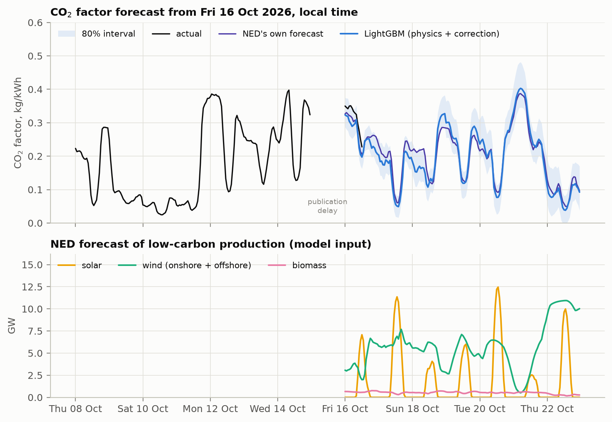

# CO₂ factor forecast for Dutch electricity, 7 days ahead

Hourly forecast of the CO₂ emission factor (kg CO₂/kWh) of electricity production in the Netherlands for the
next 7 days (168 values), based on the forecasted production of solar, wind and biomass from the
[Nationaal Energie Dashboard](https://ned.nl) (NED). Method, assumptions and results are in the report:
[report/report.pdf](report/report.pdf) (source: [report/report.md](report/report.md)).

**In short.** The CO₂ factor is close to an accounting identity: the intensity of the non-low-carbon
generation times one minus the low-carbon share of production. A LightGBM model learns the correction to this
physics estimate from NED's renewables forecasts, calendar features and the history visible when the forecast
is made. Backtest over the last year (Oct 2025 – Oct 2026), MAE in kg CO₂/kWh:

| Model | Perfect renewables | Realistic forecast errors |
|---|---:|---:|
| **LightGBM (physics + correction)** | **0.021** | **0.031** |
| Ridge | 0.028 | 0.037 |
| Physics identity, no training | 0.037 | 0.049 |
| Seasonal naive (same hour last week) | 0.089 | 0.089 |



## Quick start

Docker is the only requirement.

1. The NED files used for the report are in `data/raw/ned/`. For a fresh forecast, create a free account at
   [ned.nl](https://ned.nl/nl/dataportaal/dataportaal-overzicht) and replace the current-year and 7-day forecast
   files listed below with new downloads, keeping the file names.
2. Run:

```bash
docker compose run --rm forecast
```

This validates the data, runs the backtests, refits the model on all history and forecasts the 168 hours
covered by NED's latest forecast files (about 3 minutes). Results go to `output/`.

Other commands:

```bash
docker compose run --rm forecast forecast   # only refit and forecast (fast), reuses output/interval_quantiles.csv
docker compose run --rm forecast evaluate   # score output/forecast.csv once newer actuals are downloaded
docker compose run --rm tests               # unit tests, including the leakage test
docker compose run --rm lint                # ruff
docker compose run --rm report              # build report/report.pdf from report/report.md
```

On Linux with a user id other than 1000 add `--user "$(id -u):$(id -g)"` so the output files are yours.

Without Docker (Python 3.12):

```bash
python -m venv .venv && . .venv/bin/activate
pip install --require-hashes -r requirements-dev.txt
python -m co2_forecast
```

## Data

NED portal pages and files (hourly, "Uur Data"):

| Portal page | Yearly actuals, 2021–2026 | 7-day forecast |
|---|---|---|
| Totale elektriciteitsproductie | `electriciteitsmix-YYYY-uur-data.csv` | `totaal-elektriciteitsmix-uur-voorspelling-aankomende-7-dagen.csv` |
| Zonne-energie | `zon-YYYY-uur-data.csv` | `zon-uur-voorspelling-aankomende-7-dagen.csv` |
| Windenergie op land | `wind-YYYY-uur-data.csv` | `wind-uur-voorspelling-aankomende-7-dagen.csv` |
| Windenergie op zee | `zeewind-YYYY-uur-data.csv` | `zeewind-uur-voorspelling-aankomende-7-dagen.csv` |
| Biomassa | `biomassa-YYYY-uur-data.csv` | `Biomassa-uur-voorspelling-aankomende-7-dagen.csv` |

Optional: the `*-afgelopen-dag.csv` files (today's actuals) let the run compare the first forecast hours with
what already happened. Other files in the folder, older years and browser duplicates such as `x (1).csv` are
ignored. Download the forecast files on the same day as the current-year file: the model expects actuals up to
24 hours before the forecast start, as NED publishes them with that delay.

The repository includes the 40 files used for the report, downloaded on 16 October 2026, with their
SHA-256 checksums: [data/raw/ned/SOURCE.md](data/raw/ned/SOURCE.md). Source: Nationaal Energie Dashboard
(ned.nl); NED allows free use of its data with attribution.

## Output

| File | Content |
|---|---|
| `output/forecast.csv` | the forecast: UTC and local time, value, 80% interval, NED's own CO₂ forecast, the renewables input |
| `output/backtest_summary.csv` | MAE, RMSE, WAPE, bias and skill of every model, validation and test year, each scenario |
| `output/backtest_by_lead_day.csv` | MAE per lead day |
| `output/backtest_test_predictions.csv.gz` | every test-year hourly forecast of every model next to the actual value |
| `output/feature_importance.csv`, `feature_group_importance.csv` | permutation importance on the test year |
| `output/interval_quantiles.csv`, `interval_coverage.csv` | the 80% interval per hour ahead and its coverage on the test year |
| `output/data_summary.csv`, `data_issues.csv` | yearly statistics and what the data checks found |
| `output/live_check.csv` | first forecast hours that already happened, ours vs NED |
| `output/figures/*.png` | all figures of the report |

## Code

```
co2_forecast/
  config.py      problem definition: horizon, publication delay, NED series, backtest periods
  data.py        reading and validating NED CSV exports
  features.py    (origin, hour ahead) rows: calendar, history visible at the origin, physics estimate
  models.py      baselines, physics identity, Ridge, LightGBM behind one fit/predict interface
  evaluation.py  rolling-origin backtest, synthetic renewable forecast errors, metrics, intervals
  plots.py       report figures
  pipeline.py    everything together and the command line
tests/           data checks, leakage, model contract, backtest rules, metrics
report/          report.md and the built report.pdf
```

The parts only meet through data frames: `data` knows nothing about features, `features` nothing about
models, and the backtest runs whatever is registered in `models.MODELS`. To add a model:

1. write a class with `name`, `fit(rows)` and `predict(rows)` in `models.py`;
2. register it in `MODELS`.

The backtest, the summary tables and the lead-day figure pick it up, and `tests/test_models.py` checks the
contract. Features are added in `features.build_rows`; the leakage test guards the information set.

## Security and reproducibility

- Dependencies are pinned with hashes (`uv pip compile --generate-hashes`), so pip refuses anything that
  changed. The base images are pinned by digest.
- All containers run without network access, with a read-only file system, no Linux capabilities and a
  non-root user; the project is mounted read-only, only `output/` (and `report/` for the report) is writable.
- The code reads local CSV files only: no network calls, no credentials. pip is removed from the runtime image.
- Scans before publishing (16 October 2026): pip-audit — no known vulnerabilities in the pinned dependencies;
  Trivy — no fixable and no critical vulnerabilities in the image, no secrets or misconfigurations in the
  files; Semgrep (267 rules for Python, Docker and secrets) — no findings; Gitleaks — no secrets;
  Hadolint — clean Dockerfile.
