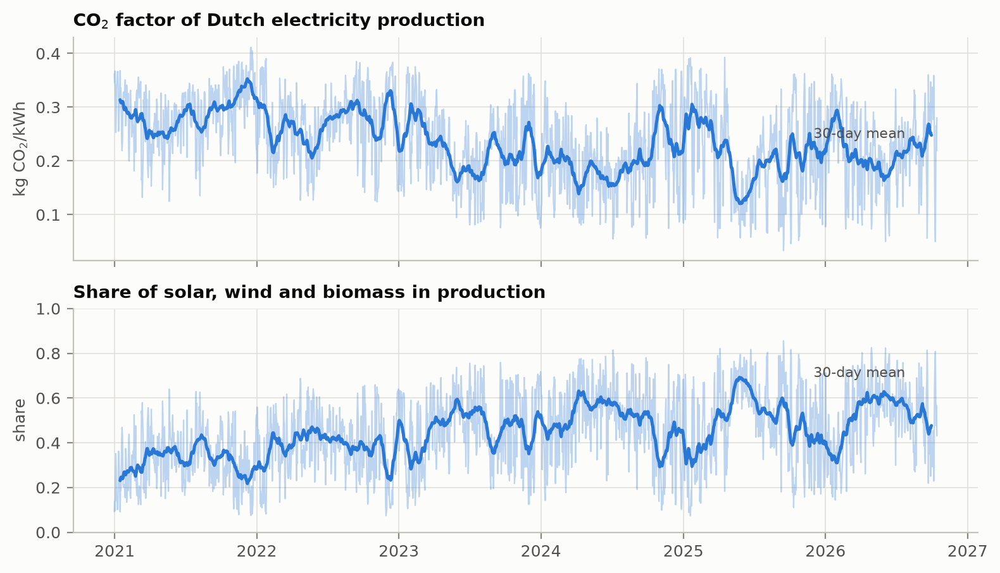
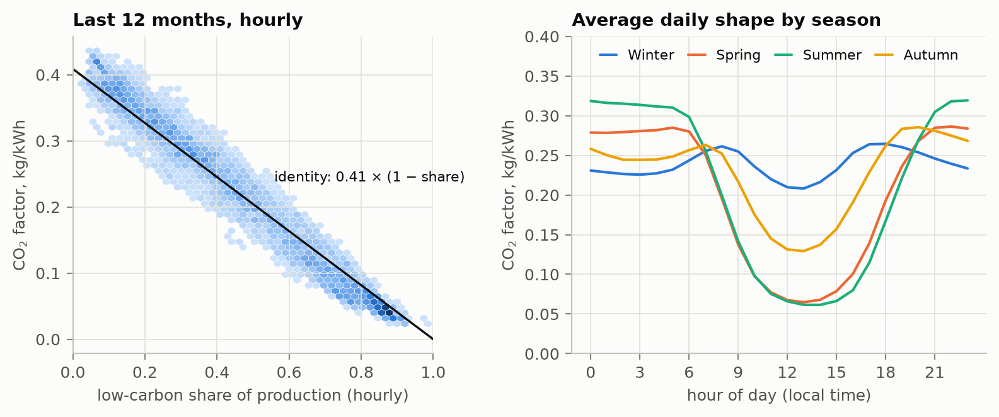
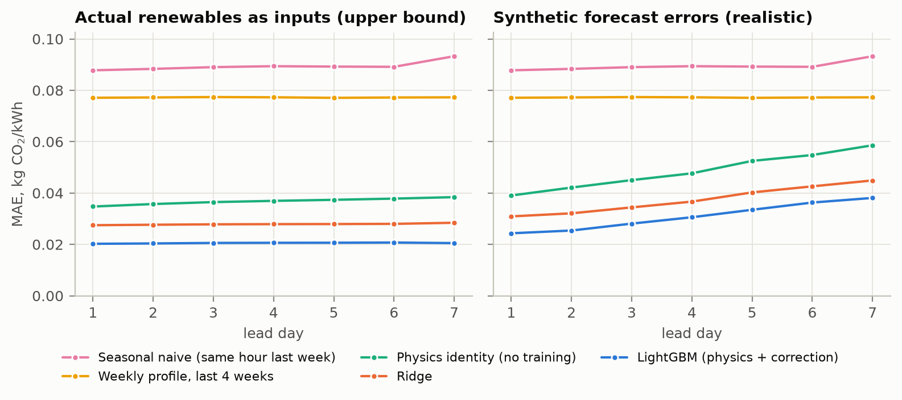
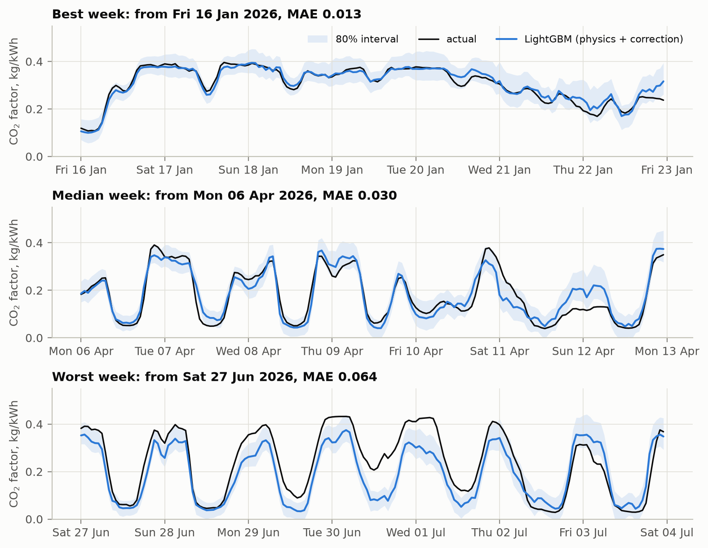
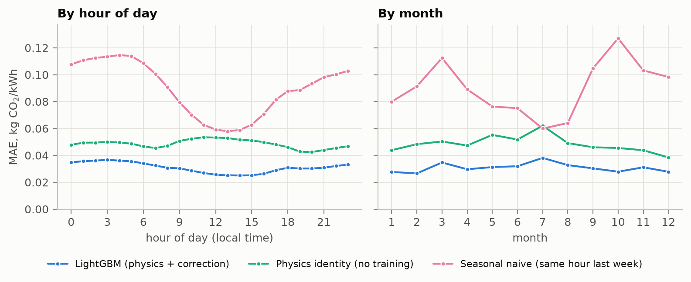
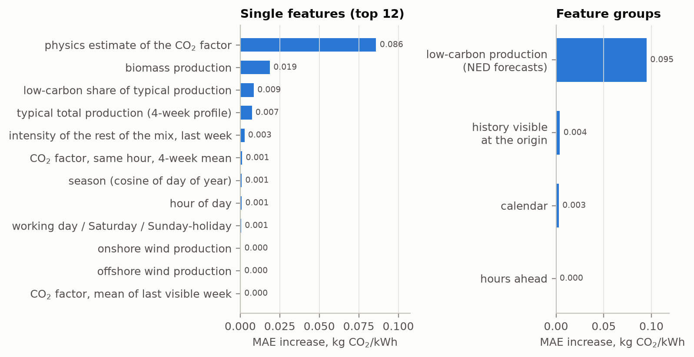

# Summary

- **Task.** Forecast the hourly CO₂ factor (kg CO₂ per kWh) of Dutch electricity production for the next
  7 days, i.e. 168 values, from forecasted renewable production. Data: Nationaal Energie Dashboard (NED),
  January 2021 – October 2026, hourly.
- **Key insight.** The CO₂ factor is close to an accounting identity: *CO₂ factor = (CO₂ intensity of the
  generation that is not solar, wind or biomass) × (1 − low-carbon share of production)*. Hourly, the factor
  and the low-carbon share correlate at r = −0.97. Forecasting the factor therefore means forecasting three
  things: low-carbon production (NED publishes 7-day forecasts of it), total production at that hour, and the
  slowly drifting intensity of the rest of the mix.
- **Model.** A single LightGBM model learns a correction to this physics estimate for all 168 hours at once,
  from NED's forecasts of solar, onshore and offshore wind and biomass, calendar features and what is known
  about the mix when the forecast is made.
- **Results** on a rolling backtest over the last year (359 weekly forecasts, Oct 2025 – Oct 2026): MAE
  0.021 kg/kWh (WAPE 9.4%) if renewable production were known exactly, and 0.031 (WAPE 14.2%) with realistic
  synthetic forecast errors. That is 65% below the seasonal-naive baseline and 17% below Ridge regression.
  The 80% prediction interval, calibrated on the previous year, covers 81.9% of the test year.
- **Forecast for 16–22 October 2026** (Figure 7): mean 0.202 kg/kWh, from 0.04 at noon on 22 October
  (strong wind and sun) to 0.40 in the calm early morning of 21 October. It stays within 0.019 kg/kWh on average of NED's own CO₂ forecast.

# Data

**Sources.** NED data portal (free account): hourly exports for 2021–2026 of total electricity production
("Elektriciteitsmix", with the CO₂ emission factor — the target), solar ("Zon"), onshore wind ("Wind"),
offshore wind ("Zeewind") and biomass ("Biomassa"), plus NED's 7-day hourly forecasts of the same five
series, downloaded on 16 October 2026.

**Preparation** (`co2_forecast/data.py`). Every file is checked against what its name promises: the 13-column
layout, series type, hourly granularity, UTC timestamps, classification (actual or forecast) and one-hour
intervals. Energy per hour (kWh) is converted to average power (MW). Duplicates, implausible values and NED's
zero code for a missing emission factor are set aside and logged (`output/data_issues.csv`). All series are
aligned on a complete hourly UTC grid; calendar features use Amsterdam local time. The data turned out to be
very clean: 50,711 consecutive hours from 1 January 2021 to 14 October 2026, with 25 missing offshore wind
values and nothing else.

**Publication delay.** On 16 October the yearly files end on 14 October at midnight local time. A forecast
issued at midnight therefore cannot see the last 24 hours. The backtest reproduces this delay exactly.

**What the data shows** (Figures 1 and 2).

- The CO₂ factor fell from 0.289 kg/kWh in 2021 to 0.201 in 2024 while the low-carbon share rose from 31% to
  50%; since then it has been flat at 0.21–0.22. The share of hours below 0.1 kg/kWh grew from 0.5% to 25%.
- Hour by hour, the factor is an almost linear function of the low-carbon share. The slope is the CO₂
  intensity of the remaining generation (gas, coal, waste, nuclear), which moves between 0.30 and 0.47 by
  month, for example when coal and gas swap places in the merit order.
- Solar shapes the day: in summer the factor drops to about 0.06 at noon and returns to 0.30 in the evening.
- History alone cannot carry a week-ahead forecast: autocorrelation is 0.73 at 24 hours and 0.53 at 168
  hours. The signal has to come from the renewables forecasts.
- Biomass production correlates positively with the factor (+0.6). Biomass units are dispatched together with
  fossil plants (correlation 0.65–0.75 with non-low-carbon production in 2025–2026), so biomass works as a proxy for
  dispatchable generation, and NED forecasts it too.

{width=100%}

{width=100%}

# Problem framing

**Direct multi-horizon model.** Every training row is a pair (forecast origin, hour ahead *h* = 0…167),
with an origin at every local midnight. One model with *h* as a feature replaces 168 separate models and
avoids the error accumulation of a recursive model.

**Information set at the origin**, enforced in `co2_forecast/features.py` and covered by a leakage test:

1. *Inputs at the target hour:* NED forecasts of solar, onshore and offshore wind and biomass (actual
   production during training, see §5.2); calendar: local hour, day type (working day, Saturday,
   Sunday or Dutch public holiday), season.
2. *History visible before origin − 24 h:* the seasonal-naive value, 4-week means of the CO₂ factor and of
   total production at the same hour of the week, means of the last visible day and week, and the CO₂
   intensity *I* of the non-low-carbon generation over the last visible week.
3. *Physics features:* low-carbon share *s* = forecasted low-carbon production / typical total production at
   that hour, and the physics estimate $\mathrm{EF}_{phys} = I \cdot (1 - s)$.

# Models

| Model | How it forecasts | Role |
|:---------------|:----------------------------------------------------|:------------------------------|
| Seasonal naive | same hour one week earlier (two weeks for day 7, because of the delay) | baseline |
| Weekly profile | mean of the same hour of the week over the last 4 visible weeks | smoother baseline |
| Physics identity | $\mathrm{EF}_{phys}$, no training | what the identity alone explains |
| Ridge | linear model on all features, one-hot hour and day type | interpretable learned model |
| **LightGBM** | gradient boosting learns the correction $\mathrm{EF} - \mathrm{EF}_{phys}$ | final model |

: Models compared. All of them produce the 168 hourly values from the same information set.

**Why LightGBM on top of the physics estimate.** The identity is strong but not exact. Total production is not
known in advance and itself depends on renewables, because the Netherlands exports when wind is strong. The
link to the hour, the season and biomass dispatch is non-linear. Trees capture these effects, while the
physics estimate carries the bulk of the signal and the level of the intensity, which trees could not
extrapolate on their own. Settings: 600 trees, learning rate 0.05, 63 leaves, at least 200 samples per leaf,
row and feature subsampling of 0.7 and 0.8.

**Choices made on the validation year only** (October 2024 – October 2025). The following variants all moved
MAE by at most ±3%: residual vs direct target, monotone constraints, L1 loss, 31 or 127 leaves, 300 or 1,200
trees, 1- or 2-year training windows. The simplest robust option was kept. The ablations matter more: without
any history (and therefore without the physics estimate) MAE grows by 15%, without the physics features by
3%, without biomass as a separate feature by 21%. Biomass stays useful (+13%) even with doubled forecast errors.

# Evaluation

## Protocol

Forecasts are issued at every local midnight. Models are refitted every 28 days on all rows whose target hour
was visible at that moment, using an expanding window from February 2021. Every second origin is used for
training, because neighbouring origins share most of their target hours. The validation year served for all
choices; the test year (15 October 2025 – 14 October 2026: 359 origins, 60,312 hourly forecasts) was used once.
Metrics: MAE in kg/kWh (primary), RMSE, WAPE = Σ|error| / Σ actual, bias, and skill = MAE reduction relative to
the seasonal-naive baseline.

## The main assumption: renewable forecasts

NED does not publish an archive of its past forecasts, so the backtest cannot use the forecasts that were
actually available at each origin. Two scenarios bracket reality:

- **Perfect renewables:** actual production as input — an upper bound on accuracy.
- **Synthetic forecast errors:** actuals are distorted by errors that grow with the lead time. Wind: standard
  deviation 6% of installed capacity on day 1 rising to 18% on day 7, autocorrelated over hours, onshore and
  offshore correlated at 0.7. Solar: relative error 15% → 40%. Biomass: 10% → 25%. All errors preserve the
  mean. These levels are typical of aggregated national forecasts; a pessimistic variant doubles them.

Models are trained on actuals in both scenarios. Training on noisy inputs was tested: it helped only in the
doubled-error case and was slightly worse otherwise.

The 13 hours of 16 October that had already happened by download time show why this matters. NED's forecast
overestimated solar, onshore and offshore wind by about 50% in those hours, so both NED's own CO₂ forecast
(MAE 0.026) and ours (0.036) came out too low. One morning is not a statistic, but it shows that input errors,
not the model, dominate the error budget.

## Results

| Model | MAE, perfect inputs | WAPE | MAE, realistic inputs | WAPE | Skill |
|:------------------|----------------------:|--------:|------------------------:|--------:|-------:|
| **LightGBM** | **0.0205** | **9.4%** | **0.0309** | **14.2%** | **65%** |
| Ridge | 0.0279 | 12.8% | 0.0374 | 17.2% | 58% |
| Physics identity | 0.0368 | 16.9% | 0.0485 | 22.3% | 46% |
| Weekly profile | 0.0772 | 35.5% | 0.0772 | 35.5% | 14% |
| Seasonal naive | 0.0895 | 41.2% | 0.0895 | 41.2% | 0% |

: Test-year backtest, MAE in kg CO₂/kWh. Skill = MAE reduction against the seasonal-naive baseline, realistic scenario. Validation-year results are similar (LightGBM 0.023 and 0.033).

- **By lead time** (Figure 3). With perfect inputs the error is flat (0.020–0.021 from day 1 to day 7). With
  realistic inputs it grows from 0.024 to 0.038, so the growth comes from the renewables forecast, not from
  the model. With doubled errors LightGBM reaches MAE 0.046, still 49% better than the seasonal-naive baseline.
- **Uncertainty.** The 80% interval is built from residual quantiles for every hour ahead (validation year,
  realistic scenario). It covers 81.9% of the test year. The forecast uses the test-year quantiles. Their
  width depends on the assumed input errors.
- **Examples** (Figure 4): the best, median and worst weeks of the test year.

{width=100%}

{width=100%}

# Error analysis and feature importance

- **What the model relies on** (Figure 6). Permutation importance on the test year, with realistic inputs,
  shuffling all columns of a source together and recomputing the derived features:
  - NED's low-carbon forecasts: MAE grows by 0.095, so they carry nearly all of the signal;
  - history visible at the origin: +0.004;
  - calendar: +0.003;
  - hour ahead: about 0.

  Among single features the physics estimate (0.086) and biomass (0.019) dominate. Wind and solar look
  unimportant one by one only because the model reads them through the physics estimate.
- **When the errors happen** (Figure 5). Night and evening hours have the largest errors (0.033–0.037) and noon
  the smallest (0.025): solar is easier to anticipate than fossil dispatch at night. By month, July (0.038) and
  March (0.035) are the hardest.
- **Worst weeks** (MAE 0.058–0.064, mid-March, late June to early July, late September 2026). In each of them
  the CO₂ intensity of the non-low-carbon generation rose during the week: 0.374 at the origin against 0.443
  realised in the week from 18 March, and 0.402 against 0.439 from 27 June. This is fuel switching or plant
  availability, which the model only sees with a delay. The slight overall underestimation (bias −0.004
  kg/kWh) reflects the same upward drift of the intensity in 2026: about 0.36 in 2025, 0.42 in summer 2026.

{width=100%}

{width=100%}

# Forecast for 16–22 October 2026

The forecast uses NED's forecasts published on 16 October (Figure 7, values in `output/forecast.csv` with the
80% interval). Daily means: 0.26, 0.15, 0.19, 0.23, 0.20, 0.30 and 0.08 kg/kWh. The lowest factor comes with
strong wind and sun on 22 October, the highest with the calm early morning of 21 October. The model and NED's own CO₂
forecast differ by 0.019 kg/kWh on average. They share the renewables input but were built separately, so the
agreement is reassuring. Once the actuals are published, `python -m co2_forecast evaluate` scores both
forecasts.

{width=100%}

# Limitations and next steps

1. **Real forecasts instead of synthetic errors.** If the NED API keeps historical forecasts
   (`classification=forecast`), the model could be trained and evaluated on what was actually known at each
   origin, and compared with NED's own CO₂ forecast over a full year.
2. **Explain the intensity of the rest of the mix.** Gas, coal and CO₂ prices, plant unavailability
   (ENTSO-E/REMIT), cross-border flows and temperature target exactly the worst weeks.
3. **Use NED's forecast of total production** instead of the 4-week profile as the denominator of the share.
4. **Probabilistic training** (quantile models or conformal intervals by regime) instead of global residual
   quantiles.
5. **Operations.** Monthly retraining; monitoring of data delay and stale forecast files; this backtest as a
   regression test.

# Reproducibility

Code, a README and setup instructions are in the repository. Everything runs in Docker:

```
docker compose run --rm forecast   # data checks, backtests, forecast: about 3 minutes
docker compose run --rm tests      # unit tests, including the leakage test
docker compose run --rm report     # this PDF
```

Dependencies are pinned with hashes. Containers run without network access,
with a read-only file system and no Linux capabilities. The NED files used here are included with their checksums
(source: Nationaal Energie Dashboard, ned.nl, used with attribution).
